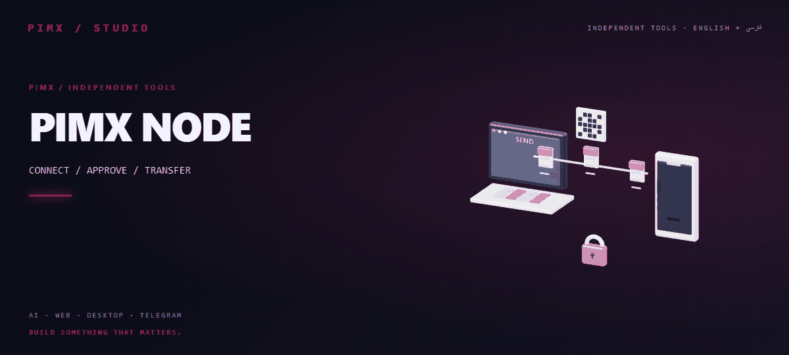
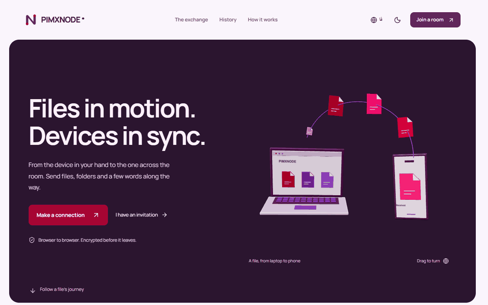

<div align="center">

<a href="https://pimxnode.pages.dev/"></a>

[English](README.md) · [فارسی](README.fa.md) · [Live website ↗](https://pimxnode.pages.dev/)

[](https://github.com/MOHAMMADREZAABEDINPOOR/PIMX_NODE)

</div>

# PIMX NODE

Send files, folders and text between browsers through encrypted WebRTC connections. Invite devices by QR, approve recipients, manage transfer queues and verify file integrity; signaling runs on Node.js or Cloudflare Durable Objects.

<a href="https://pimxnode.pages.dev/"></a>

[Preview of the redesigned interface · PNG](assets/readme/redesign.png) · [Static artwork](assets/readme/hero.png)

## What you can do

- QR rooms, recipient approval and multi-recipient file/folder/text sharing
- Queue controls, reconnect/resume and file integrity verification
- Live 3D connection state, diagnostics, local history and installable PWA

## A room for your devices

Create a room and invite another browser with its link or QR code. Approve incoming transfers, send individual files or folders, share text and choose recipients. Queue controls, reconnect/resume, previews, connection diagnostics and local transfer history help you follow actual progress. The 3D network responds to connection and transfer events.

WebRTC carries file data with encrypted chunks and integrity verification. The signaling service coordinates peers without storing file contents. A TURN relay may carry encrypted traffic when direct connections fail. Keep both browsers online and open; offline installation does not make live transfers work without a connection. Resume depends on available session state and source files, and previews depend on browser format support.

## Run locally

Use Node.js 22.12 or newer.

```sh
npm ci
npm run dev
```

Open the server on two browsers and join the same room. Check [.env.example](.env.example) for `PORT`, optional TURN configuration and `VITE_SITE_URL`.

| Command | Purpose |
| --- | --- |
| `npm run lint` | TypeScript checks for app and Cloudflare Worker |
| `npm test` | Playwright transfer and interface checks |
| `npm run build:pages` | Static frontend and SEO pages |
| `npm run build` | Frontend plus Node signaling server |
| `npm start` | Run `build/server.cjs` after building |

## Two deployment paths

For Cloudflare, deploy the signaling Worker first with `npm run deploy:signaling`, then the Pages frontend with `npm run deploy:pages`. The `SIGNALING` service binding connects Pages WebSocket requests to a `SignalingRoom` Durable Object. A static frontend by itself cannot provide signaling.

For Node hosting, run `npm run build` followed by `npm start`, behind an HTTPS/WSS reverse proxy. TURN is optional; restricted networks can require it. Configure `TURN_URL` and either `TURN_SHARED_SECRET` for temporary credentials, or the scoped `TURN_USERNAME`/`TURN_CREDENTIAL` alternative.

See [Cloudflare and Node deployment](DEPLOYMENT.fa.md), [implementation](IMPLEMENTATION.fa.md), [SEO](SEO.md), [transfer source](src/) and [Worker source](cloudflare/). The interface supports Persian/English, RTL, light/dark themes, keyboard navigation and reduced motion.

[GitHub](https://github.com/MOHAMMADREZAABEDINPOOR/PIMX_NODE) · [PIMX](https://github.com/MOHAMMADREZAABEDINPOOR) · [Portfolio](https://pimx.pages.dev/)
